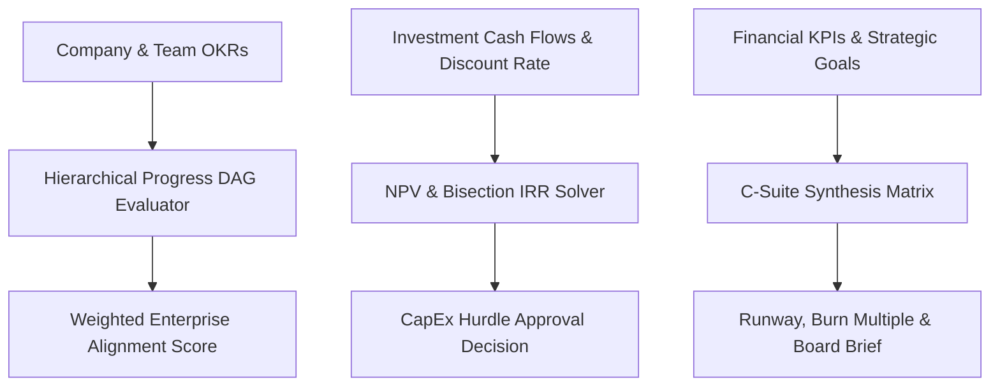

# genpark-accio-csuite-manager


GenPark Accio C-Suite Manager is a zero-dependency executive decision-support and corporate governance engine implementing hierarchical OKR progress DAG alignment, capital expenditure financial hurdle rate analysis (Net Present Value NPV and Internal Rate of Return IRR), and board briefing synthesis matrices.



## Features
- **Hierarchical OKR Alignment**: Maps department and team key results to high-level corporate strategic objectives with automated status propagation.
- **CapEx Financial Hurdle Solver**: Evaluates capital deployment using exact discounted cash flow (NPV) and iterative IRR root finding.
- **Executive Governance Brief**: Computes corporate burn multiple, cash runway, and strategic initiative health for board reporting.

## Quickstart

```python
from client import GenParkAccioCSuiteManager

csuite = GenParkAccioCSuiteManager()
res = csuite.calculate_capex_npv_and_irr(100000.0, [30000, 40000, 50000, 60000], 0.12)
print("NPV:", res["net_present_value_usd"], "IRR:", res["internal_rate_of_return_pct"])
```

## License
MIT
